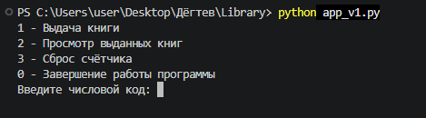
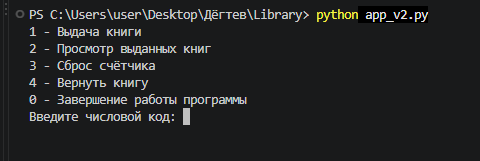
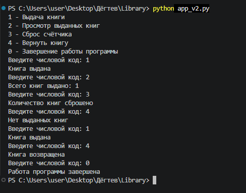

# Учёт книг

## Описание
Программа, предназначенная для выдачи и возвращения книг из библиотеки

## Файлы
- app_v1.py - Первая версия программы
- app_v2.py - Вторая версия программы

## Инструкция по запуску
В терминале написать "python app_v1.py" для запуска версии 1

В терминале написать "python app_v2.py" для запуска версии 2

## Как пользоватся

1. Для выдачи книги нажмите 1
2. Для просмотра количества выданных книг нажмите 2
3. Для сброса счётчика книг нажмите 3
4. Для возвращения книги обратно нажмите 4 (в версии 2)
5. Для завершения работы нажмите 0

### Выполнил
Дёгтев Павел Кириллович 11ТЭС